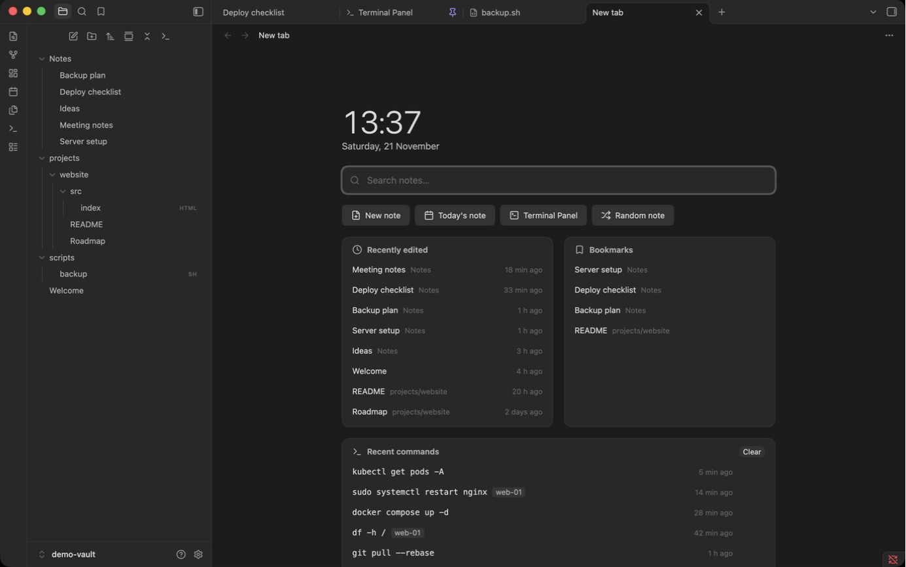
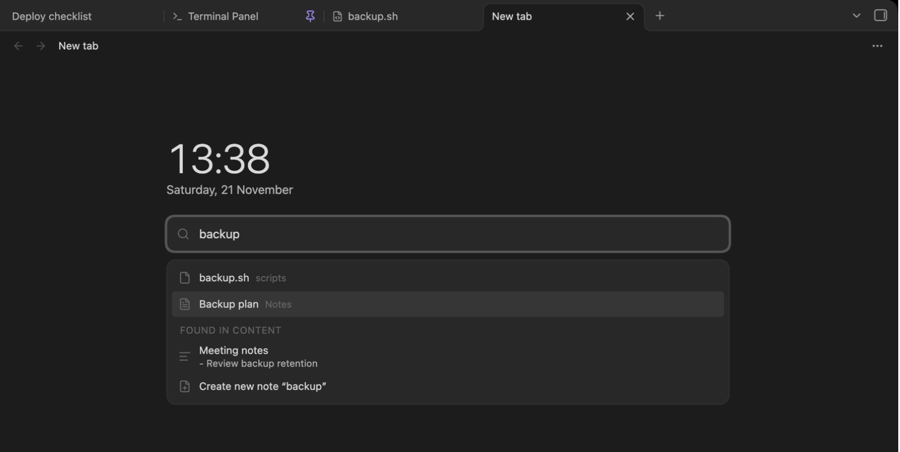

# ecu-newtab

A new tab that is actually useful: search, recent notes, bookmarks and your recent terminal
commands, all on the empty tab you open with `Cmd/Ctrl+T`.

## Features

- **Search** right away: the cursor is in the search box when the tab opens. Matches note
  names first, then note contents with a short snippet. Arrow keys to move, `Enter` to open in
  the same tab, `Cmd/Ctrl+Enter` to open in a new tab. No match? Create a note with that name.
- **Quick actions**: new note, today's daily note, Terminal Panel, random note.
- **Recently edited** notes with their folder and how long ago they changed.
- **Bookmarks** from Obsidian's Bookmarks core plugin.
- **Recent commands** from [ecu-terminal](https://github.com/erencanucarr/ecu-terminal):
  click one to run it again, or copy it. Commands that ran over SSH show the host and are only
  typed into the terminal (no Enter), so you decide where they run. Commands containing words
  like password, token or secret are never recorded.
- Clock and date at the top. Every section can be switched off in the settings.

## Install

1. From the [latest release](https://github.com/erencanucarr/ecu-newtab/releases/latest),
   download `main.js`, `manifest.json` and `styles.css` into
   `<your vault>/.obsidian/plugins/ecu-newtab/`.
2. In Obsidian, open **Settings > Community plugins**, turn off Restricted mode if needed,
   and enable **ecu-newtab**.
3. Open a new tab.

Optional companions: [ecu-terminal](https://github.com/erencanucarr/ecu-terminal) for the
Terminal Panel button and recent commands, and
[ecu-codekit](https://github.com/erencanucarr/ecu-codekit), which runs commands with a safety
check for risky ones. Without them those parts simply don't show up.

The plugin makes no network requests.

## Language

The interface is available in English and Turkish. By default it follows Obsidian's language;
you can pick one under **Settings > ecu-newtab > Language**.

## License

MIT, see [LICENSE](LICENSE).
